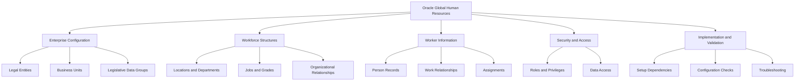
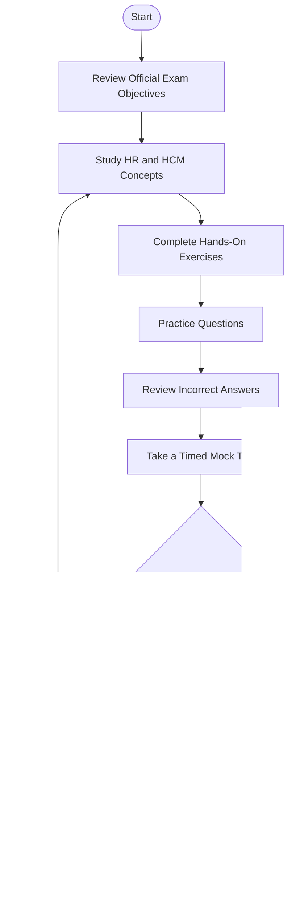
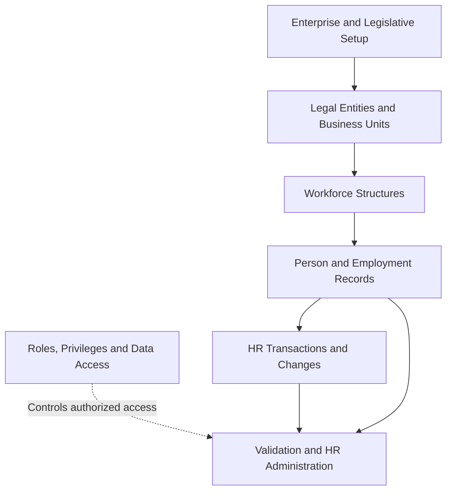
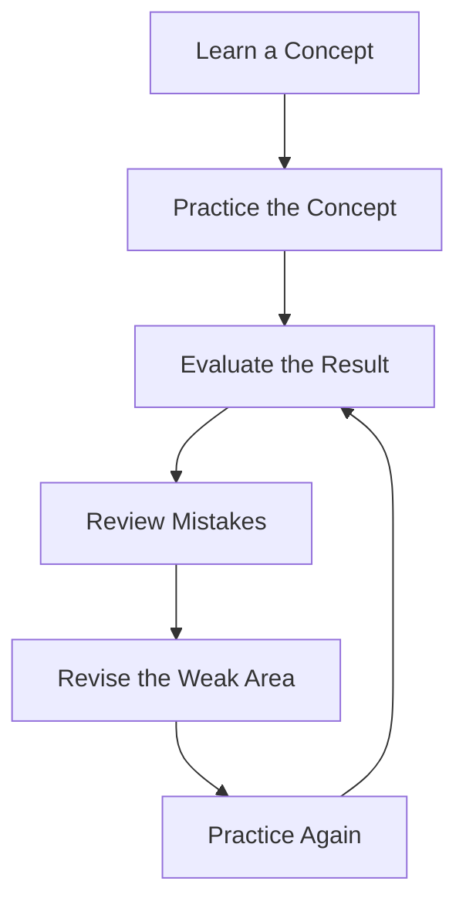
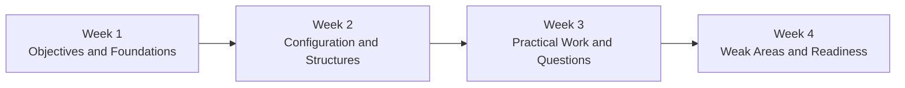

# Oracle Global Human Resources Cloud 2026 Implementation Professional (1Z0-1046-26)

Prepare for the **Oracle Global Human Resources Cloud 2026 Implementation Professional** certification with a structured study guide covering Oracle Fusion Cloud HCM, workforce structures, implementation configuration, security, practical exercises, and exam preparation strategies.

This repository is an independent learning resource for candidates who want to understand how Oracle Global Human Resources supports enterprise HR processes and how implementation decisions affect the system.

**Official exam code:** `1Z0-1046-26`  
**Certification provider:** Oracle  
**Additional preparation resource:** [CertsGate – 1Z0-1046-26](https://certsgate.com/exams/oracle/1z0-1046-26)

## Table of Contents

- [About the Certification](#about-the-certification)
- [Who Should Prepare for This Exam?](#who-should-prepare-for-this-exam)
- [Exam Information](#exam-information)
- [Skills and Knowledge Areas](#skills-and-knowledge-areas)
- [Official Exam Objectives](#official-exam-objectives)
- [Understanding Oracle Global Human Resources](#understanding-oracle-global-human-resources)
- [Conceptual Skills Map](#conceptual-skills-map)
- [Certification Preparation Flowchart](#certification-preparation-flowchart)
- [Technical Architecture Diagram](#technical-architecture-diagram)
- [Circular Study and Revision Cycle](#circular-study-and-revision-cycle)
- [Step-by-Step Preparation Guide](#step-by-step-preparation-guide)
- [Recommended Study Schedule](#recommended-study-schedule)
- [Practice Questions and Mock Tests](#practice-questions-and-mock-tests)
- [Hands-On Labs and Practical Exercises](#hands-on-labs-and-practical-exercises)
- [Common Preparation Mistakes](#common-preparation-mistakes)
- [Certification Benefits and Career Relevance](#certification-benefits-and-career-relevance)
- [Frequently Asked Questions](#frequently-asked-questions)
- [Official and Additional Learning Resources](#official-and-additional-learning-resources)
- [About CertsGate](#about-certsgate)
- [Disclaimer](#disclaimer)

---

## About the Certification

The Oracle Global Human Resources Cloud 2026 Implementation Professional certification focuses on the knowledge needed to implement and configure Oracle Fusion Cloud Human Capital Management (HCM) Global Human Resources capabilities.

Global Human Resources provides functionality for maintaining worker information, managing employment records, organizing enterprise workforce structures, and supporting HR operations across an organization.

Implementation work involves more than understanding HR terminology. Candidates should learn how enterprise structures relate to workforce records, how setup decisions influence business processes, and how roles and data access affect the information users can manage.

Start with the [Oracle Global Human Resources documentation](https://docs.oracle.com/en/cloud/saas/human-resources/faigh/overview-of-global-human-resources.html) to understand the product's purpose and implementation context.

## Who Should Prepare for This Exam?

This certification may be relevant to:

- Oracle Fusion Cloud HCM implementation consultants.
- HRIS and HR technology professionals.
- Functional consultants working with enterprise HR applications.
- HR systems analysts who support Oracle Cloud HCM.
- IT professionals moving into Oracle HCM implementation.
- Consultants who want to strengthen their knowledge of workforce configuration.

Experience with HR operations, organizational structures, employee records, and enterprise application configuration can help learners understand the concepts more quickly.

Beginners can also use this guide, but should build their understanding of HR business processes and Oracle Fusion Cloud navigation before attempting advanced implementation scenarios.

## Exam Information

The following information identifies the certification and provides a starting point for planning.

| Item | Information |
|---|---|
| Certification | Oracle Global Human Resources Cloud 2026 Implementation Professional |
| Exam code | 1Z0-1046-26 |
| Provider | Oracle |
| Product area | Oracle Fusion Cloud HCM — Global Human Resources |
| Main preparation focus | HR functional concepts, configuration, implementation workflows, and practical application |
| Official documentation | Oracle Help Center |
| Supplementary practice | [CertsGate preparation page](https://certsgate.com/exams/oracle/1z0-1046-26) |

Oracle's published 2026 certification listing identifies the localized Japanese version of this exam as a 90-minute assessment with 36 questions and a 68% passing score. Exam conditions and localized versions can differ, so verify the current details for your registration region on the [official Oracle certification listing](https://www.oracle.com/jp/education/certification/certification-exam-list/).

Oracle also lists `1Z0-1046-26` among its hands-on performance-based exams. Review the [Oracle explanation of hands-on performance exams](https://docs.oracle.com/en/education/customer-success/digital-learning-kit/ml-cert-faq/topics/HandsOnPerformanceExams.html) to understand this assessment approach.

## Skills and Knowledge Areas

A useful preparation plan should connect the product's functional areas with real implementation tasks.

| Knowledge area | What to understand |
|---|---|
| Enterprise configuration | Enterprise information, legal entities, business units, and organizational requirements |
| Workforce structures | Locations, departments, jobs, grades, and positions where applicable |
| Person and employment records | Worker information, work relationships, assignments, and employment changes |
| Legislative configuration | Legislative Data Groups and relevant country-specific requirements |
| Reference data | Reference data sets and how reference data is shared |
| Security | Roles, privileges, and appropriate access to HR information |
| Implementation workflow | Setup prerequisites, configuration dependencies, and validation |
| Troubleshooting | How to investigate configuration problems and unexpected application behavior |

This table is an **independent study overview**, not a representation of official exam-domain weightings. Use Oracle's current exam documentation to confirm the examinable scope.

## Official Exam Objectives

Begin with the official exam page and its associated learning resources:

[Oracle MyLearn — Global Human Resources Cloud 2026](https://mylearn.oracle.com/)

Search for the exact certification title and exam code. Review the current objectives or associated learning path before deciding how to distribute study time.

For product-level preparation, Oracle's implementation documentation describes tasks such as managing enterprise structures, setting up legal entities and business units, configuring workforce structures, and defining person and employment record values.

Official implementation guide:

[Overview of Implementing Global Human Resources](https://docs.oracle.com/en/cloud/saas/human-resources/faigh/overview-of-implementing-global-human-resources.html)

Use the following checklist to organize your reading:

- [ ] Understand the purpose of Global Human Resources.
- [ ] Review enterprise structures and their relationships.
- [ ] Study legal entities, business units, and legislative data groups.
- [ ] Understand locations, departments, jobs, and other workforce structures.
- [ ] Review person records, work relationships, and assignments.
- [ ] Learn the purpose of reference data sets.
- [ ] Study roles, privileges, and data security.
- [ ] Practice navigating setup tasks and checking configuration results.
- [ ] Verify every topic against the current official exam objectives.

Do not assume that every topic in the product documentation carries equal examination weight.

## Understanding Oracle Global Human Resources

Oracle Global Human Resources connects organizational configuration with the information used to manage a workforce.

For example, creating an employee record is not an isolated task. The surrounding enterprise configuration, applicable legal employer, workforce organization, and security context can influence how the record is created and maintained.

Understanding these relationships helps candidates reason through implementation scenarios rather than simply recall menu names.

## Conceptual Skills Map

The following diagram is an independent learning map. It groups related subjects for study and does not indicate official exam weighting.

## Certification Preparation Flowchart

Follow a repeatable preparation process rather than jumping directly into intensive question practice.

The purpose of this process is to identify gaps early. A wrong answer should lead to a specific review task, not simply another attempt at the same question.

## Technical Architecture Diagram

The diagram below illustrates a conceptual relationship between enterprise setup, workforce structures, worker records, and security. It is intended to help explain the product's functional dependencies; it is not an official Oracle system architecture diagram.

When studying this model, ask yourself:

- Which setup decisions must exist before a workforce record can be configured?
- How are enterprise organization and workforce structures related?
- What changes when a worker's assignment or employment information is updated?
- Why must access to sensitive HR information be controlled?
- How would you investigate an unexpected result after configuration?

These questions encourage the kind of applied understanding needed for implementation work.

## Circular Study and Revision Cycle

Certification preparation works best as an iterative cycle. Each practice attempt should improve your understanding of a specific objective.

For example, if a question about reference data sets exposes a gap, revisit the relevant Oracle documentation, identify how the concept works, and then attempt a new scenario. Repeat the cycle until you can explain the reasoning without relying on memorized answer patterns.

## Step-by-Step Preparation Guide

### Step 1: Establish Your Baseline

Read the official exam objectives and mark each topic as familiar, partially understood, or unfamiliar.

This first assessment helps you prioritize study time. It also prevents you from spending too much time on concepts you already understand while ignoring important gaps.

### Step 2: Study Enterprise Structures

Learn the purpose of legal entities, business units, legislative data groups, and reference data sets.

Pay attention to the differences between these concepts. They may appear related in a business scenario, but each serves a different configuration purpose.

### Step 3: Understand Workforce Structures

Study how locations, departments, jobs, grades, and other relevant structures support workforce administration.

Use realistic examples, such as organizing departments across business units or assigning workers to appropriate organizational structures. Focus on why a configuration is required, not just where a setting is located.

### Step 4: Learn Worker and Employment Records

Review the relationships among person information, work relationships, and assignments.

Practice explaining how a worker's information fits into the wider organization. Where a scenario involves a change in employment or assignment, consider which records and business rules may be affected.

### Step 5: Study Security and Access

Understand the difference between authentication, role-based privileges, and access to HR data.

Review the official HCM security documentation and learn how an administrator investigates a user who cannot access an expected task or record.

### Step 6: Practice Implementation Workflows

Use Oracle documentation to follow setup tasks in their intended context. Identify prerequisites, dependencies, and validation steps.

If you have access to an appropriate training environment, perform the configuration yourself. If you do not, use documented scenarios and carefully trace the expected workflow.

### Step 7: Evaluate Your Progress

Complete practice questions after learning the relevant concepts. Review every incorrect or uncertain answer and map it back to the official objectives.

Finish with a timed assessment using a format consistent with the current exam information. Use the result to choose your final revision priorities.

## Recommended Study Schedule

The following four-week schedule is a suggested planning framework, not an official Oracle requirement. Adjust it according to your previous HCM experience and available study time.

| Period | Main focus | Suggested outcome |
|---|---|---|
| Week 1 | Exam objectives, HCM fundamentals, enterprise configuration | A completed topic checklist |
| Week 2 | Workforce structures, worker records, security | Clear understanding of key relationships |
| Week 3 | Practical exercises, scenario questions, mistake analysis | A documented list of weak areas |
| Week 4 | Timed practice, targeted revision, final review | Evidence-based readiness assessment |

If you already work with Oracle Fusion Cloud HCM, spend more time validating less familiar areas. If you are new to the platform, prioritize foundational concepts and practical demonstrations before increasing question volume.

## Practice Questions and Mock Tests

Practice questions are useful when they reveal whether you understand the underlying configuration and business requirements.

The [CertsGate 1Z0-1046-26 preparation page](https://certsgate.com/exams/oracle/1z0-1046-26) can be used as a supplementary resource for practice and knowledge checks. Compare any third-party learning material with the current Oracle documentation and objectives.

Use this process for each question:

1. Read the scenario and identify the business requirement.
2. Select an answer based on the relevant concept or configuration.
3. Review the explanation, including why alternatives may be unsuitable.
4. Identify the objective associated with any mistake.
5. Revisit the relevant official material.
6. Attempt a different scenario to confirm your understanding.

### Example Study Questions

These are original conceptual exercises for learning, not official or actual exam questions.

**Question 1: Enterprise Configuration**

An organization needs to establish its legal and organizational structure before configuring workforce information. What should an implementation consultant do first?

A. Begin creating worker assignments without reviewing prerequisites.

B. Review the required enterprise setup and implementation dependencies.

C. Assign every administrator unrestricted access to HR data.

D. Start with unrelated reporting tasks.

**Study focus:** Implementation prerequisites and enterprise configuration.

**Question 2: Workforce Structures**

A consultant needs to organize employees according to the company's departments and jobs. Which area should the consultant study?

A. Workforce structures.

B. Browser configuration.

C. External marketing campaigns.

D. Unrelated infrastructure monitoring.

**Study focus:** The purpose of organizational and workforce structures.

**Question 3: Security**

A user cannot access an HR task that should be available for their role. What is an appropriate initial investigation?

A. Grant unrestricted access immediately.

B. Check the user's relevant roles, privileges, and access configuration.

C. Delete the worker record.

D. Rebuild the entire enterprise structure without investigating.

**Study focus:** Role-based access and systematic troubleshooting.

These exercises test general reasoning. Validate the correct product-specific configuration and applicable setup requirements using Oracle's documentation.

## Hands-On Labs and Practical Exercises

Practical learning helps connect documentation with actual implementation behavior.

Use an authorized Oracle training or practice environment when available. Do not experiment with production employee data or make unauthorized configuration changes.

Suggested exercises include:

| Exercise | Learning objective |
|---|---|
| Explore enterprise setup | Understand implementation prerequisites |
| Review legal entities and business units | Distinguish enterprise organization concepts |
| Explore locations and departments | Understand workforce structure configuration |
| Trace a worker record | Relate person information, employment, and assignments |
| Review role and data access | Understand security configuration |
| Investigate a setup problem | Develop a repeatable troubleshooting method |
| Document a configuration workflow | Explain dependencies and expected results |

For every exercise, write down the business requirement, relevant configuration, prerequisites, expected result, and verification method.

Where access to an Oracle environment is unavailable, use the official implementation guide to trace the workflow and explain what each task is intended to accomplish.

## Common Preparation Mistakes

**Memorizing answers without understanding the configuration**

Remembering a particular answer does not demonstrate that you can solve a different scenario. Learn why the selected approach fits the requirement.

**Ignoring implementation dependencies**

Configuration tasks often rely on earlier setup decisions. Understand prerequisites instead of studying each menu independently.

**Treating similar HR concepts as interchangeable**

Distinguish legal entities, business units, departments, jobs, person records, work relationships, and assignments.

**Skipping security concepts**

Implementation knowledge includes understanding which users can perform tasks and access information.

**Using practice questions as the only resource**

Third-party practice material cannot replace current official objectives, documentation, and hands-on learning.

**Failing to review mistakes**

Record recurring errors and revisit the concepts responsible for them. Repeatedly answering questions without correcting misunderstandings is inefficient.

**Assuming readiness from one test result**

Use several indicators: objective coverage, practical understanding, performance across different scenarios, and the ability to explain why alternative solutions are unsuitable.

## Certification Benefits and Career Relevance

The certification is relevant to professionals who work with Oracle Fusion Cloud HCM implementations and HR technology.

Preparation can help learners develop a more organized understanding of enterprise HR configuration, workforce structures, employment information, implementation dependencies, and security considerations.

Potentially relevant roles include Oracle HCM functional consultant, HRIS analyst, HCM implementation specialist, and HR technology consultant. Actual job requirements vary by employer and experience level.

Certification alone does not establish implementation experience or guarantee employment. Practical knowledge, communication skills, business-process understanding, and experience with enterprise systems remain important.

## Frequently Asked Questions

### What is the 1Z0-1046-26 certification?

It is the Oracle Global Human Resources Cloud 2026 Implementation Professional certification, associated with Oracle Fusion Cloud HCM Global Human Resources.

### Where should I start preparing?

Start with the official exam objectives and the [Oracle Global Human Resources overview](https://docs.oracle.com/en/cloud/saas/human-resources/faigh/overview-of-global-human-resources.html). Build your study plan around verified objectives before moving into intensive practice.

### Is hands-on practice important?

Yes. Practical exercises help you understand how setup decisions and configuration relationships affect implementation workflows. Oracle also identifies this certification among its hands-on performance-based exams.

### Are practice questions enough to prepare?

Practice questions can help evaluate your understanding, but they should complement official documentation, conceptual learning, and practical exercises.

### How long should I study?

There is no single schedule that suits every candidate. Your preparation time depends on your previous Oracle HCM experience, familiarity with HR processes, access to a practice environment, and the topics you need to learn.

The four-week roadmap in this README is a suggested framework, not an official preparation-time recommendation.

### Where can I find additional practice material?

Start with [Oracle MyLearn](https://mylearn.oracle.com/) and the Oracle Help Center. You can also review the [CertsGate 1Z0-1046-26 preparation page](https://certsgate.com/exams/oracle/1z0-1046-26) for supplementary practice resources.

### Does this guide guarantee a passing result?

No. This repository supports structured learning but cannot guarantee an examination result. Readiness depends on your knowledge, practical understanding, and performance under the current exam conditions.

## Official and Additional Learning Resources

Use official Oracle resources as the foundation of your preparation.

| Resource | Purpose |
|---|---|
| [Oracle MyLearn](https://mylearn.oracle.com/) | Find the certification, associated learning path, and available training |
| [Global Human Resources overview](https://docs.oracle.com/en/cloud/saas/human-resources/faigh/overview-of-global-human-resources.html) | Understand the product's functional scope |
| [Implementing Global Human Resources](https://docs.oracle.com/en/cloud/saas/human-resources/faigh/overview-of-implementing-global-human-resources.html) | Study implementation tasks and setup dependencies |
| [Oracle HCM documentation](https://docs.oracle.com/en/cloud/saas/human-resources/) | Explore product functionality and related configuration guides |
| [Oracle hands-on performance exam FAQ](https://docs.oracle.com/en/education/customer-success/digital-learning-kit/ml-cert-faq/topics/HandsOnPerformanceExams.html) | Understand Oracle's hands-on performance-based assessment approach |
| [Oracle certification listing](https://www.oracle.com/jp/education/certification/certification-exam-list/) | Check published exam information in the listed region |
| [CertsGate preparation page](https://certsgate.com/exams/oracle/1z0-1046-26) | Explore supplementary certification preparation material |

Always verify exam availability, registration details, current objectives, and exam policies through the relevant official Oracle pages before scheduling an assessment.

## About CertsGate

[CertsGate.com](https://certsgate.com/) provides supplementary IT certification preparation resources for learners exploring different certification paths.

For this certification, the dedicated [Oracle 1Z0-1046-26 preparation page](https://certsgate.com/exams/oracle/1z0-1046-26) is a starting point for finding relevant study material and practice resources.

Use third-party material to reinforce concepts and identify areas for additional review. Keep Oracle's official documentation, verified objectives, and practical understanding at the center of your preparation.

